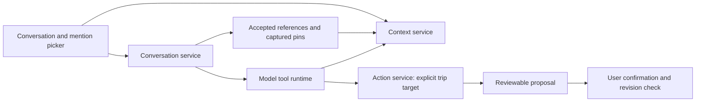

# Assistant conversations and resource context

A conversation belongs to an authenticated owner/admin, not to a trip. The tracker’s selected trip is navigation state. It must never select a chat, supply hidden context, or determine a proposal target.

## Boundaries

- `travel-assistant.mjs`, `store.mjs`, and the background workflow own conversation history, request acceptance, lifecycle, recovery, and publication.
- `context.mjs` owns typed reference validation, resource search, canonical reads, access checks, bounded assembly, and explicit trip snapshot resolution. Picker endpoints and model tools share it.
- `tool-runtime.mjs` exposes discovery/research tools and records what the model used. `gemini-adapter.mjs` orchestrates the existing bounded tool loop without a default snapshot.
- `actions.mjs` prepares changes against an explicit trip reference. The existing proposal compiler and committer retain timeline validation, revision conflict detection, confirmation, and atomic application.

`ContextRef` is `{kind, id}`. Trip, activity, source, and contribution IDs are positive database IDs represented as strings; places use `google:<placeId>`. Source numbers and activity keys are scoped domain identifiers, never cross-trip reference identities. Contributions include comments and suggestions. The pilot access boundary permits owner/admin planning reads; conversation history and pin mutations additionally require ownership.

## HTTP and model interfaces

- `POST /api/v1/assistant/turns`: existing message, conversation ID, client turn ID, and retry fields; optional `mentions` and, for a new conversation, `initialPins`.
- `GET /api/v1/assistant/workspace`: global conversation history, selected conversation, pins, turns, and recovery by request ID. Legacy trip metadata is navigation/compatibility data only.
- `GET /api/v1/assistant/context`: search with `q`, optional `kind`, `tripId`, and cursor; read with `kind` + `id`; resolve a tracker entry with `slug`.
- `PUT /api/v1/assistant/conversations/:id/pins`: `{pins, version}`; a stale version returns `CONTEXT_CONFLICT` (409).
- Model tools `search_context` and `read_context` discover data without changing pins. Existing web, Maps, and route tools remain. `stage_plan_changes` requires `{trip: ContextRef, operations}` and allows only one target per response.

Search uses paginated, parameterized PostgreSQL queries. Google Maps place search is an explicit separate picker type. No vector index or saved-place entity is introduced. Add new reference kinds to validation, search/read resolution, and presentation without changing conversation ownership.

## Context lifetime and recovery

Each message can attach up to 20 references; each conversation can pin up to 20. New-chat pins persist in its local draft until first acceptance. Pins on saved conversations live in PostgreSQL and use optimistic version checks. Drafts and pending requests are keyed by account plus conversation ID, with a separate new-chat key.

Atomic acceptance captures the message references and current pins with the request ledger and background outbox. Replayed delivery uses the accepted record, even if pins subsequently change. A manual retry retains its original references and captured pins; execution resolves current resource availability again. It does not mutate historical context.

Execution assembles compact data under a 24,000-character context budget. Full trip reads are on demand. Missing resources remain explicit unavailable references; over-budget content is explicitly omitted. Resolved input and model-discovered material are persisted with canonical labels, provenance, and revision/retrieval time. Recent history stays limited to 12 completed exchanges. Unpinning only stops automatic inclusion in future messages; it does not erase previously sent messages or facts already discussed.

Internal evidence uses validated local links and typed references; external evidence retains HTTP(S) validation. Retrieved prose is untrusted data. An attachment never authorizes a write, and discovering a resource never pins it.

## Navigation and review

The assistant opens without required context. The tracker offers “Thêm chuyến đi này”; the composer supports the picker through “Thêm ngữ cảnh” or `@`. Picking creates a visible attachment. History, close/reopen, expand/minimize, and tracker trip switching preserve the conversation and draft independently.

Proposal reviews name their target trip. The target snapshot supplies the revision and all operation identifiers; publication stores that target ID rather than copying a conversation trip. Only the existing explicit Apply flow writes itinerary data.

## Migration and rollout

The additive context migration makes the legacy conversation trip nullable with `ON DELETE SET NULL`, backfills existing trip pins, and adds turn context columns. It preserves conversation IDs, messages, proposals, retry lineage, and timestamps. Compatibility triggers capture context for rows created by older instances during rollout. A context-version marker distinguishes legacy inserts from accepted reference-aware turns, so legacy triggers cannot overwrite deliberately empty retry context. Re-adopting the migration preserves later pin edits and original turn captures. Existing trip-scoped HTTP requests remain adapters supplying a trip mention.

Before production cutover, run `pnpm exec node --env-file=.env scripts/assistant-deployment.mjs pause`. The temporary database trigger rejects new turn transactions from both API versions while existing workers finish. Use the same command with `status` until `activeRuns` is zero; it also lists pending migrations without exposing connection details. Review and apply the migration, deploy with `pnpm run deploy:prod`, then run the deployment script with `resume` to remove the gate. Always resume after a failed deployment as well; the additive schema keeps the previous application compatible. Do not remove old SQL signatures or the legacy trip column in this release. A rollback to the old UI cannot expose new no-trip chats correctly; prefer a forward fix or disable the assistant while retaining data. Production deployment is separate from implementation.

Trip deletion preserves conversations and their stored historical context. Live references become unavailable; existing trip-specific proposals retain their existing deletion/confirmation behavior.

## Verification

Unit tests cover typed identities, access rejection, context budget reporting, two-trip discovery with citations, explicit target isolation, and timezone requirements. Database/browser tests cover empty trip libraries, legacy migration, captured pins, conflicts, replay/retry, deleted references, background jobs, mentions, pinning, and navigation. Existing assistant recovery/proposal suites remain the lifecycle regression coverage. The responsive matrix is 320×760, 1440×900, and 1920×1080, including the public/admin audit.

Trip creation, cross-conversation recall, member access, and multiple write targets per response are intentionally deferred.
