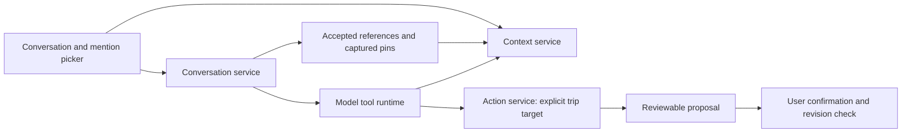

# Assistant conversations and resource context

A conversation belongs to an authenticated owner/admin, not to a trip. The tracker’s selected trip is navigation state. It must never select a chat, supply hidden context, or determine a proposal target.

## Boundaries

- `travel-assistant.mjs`, `store.mjs`, and the background workflow own conversation history, request acceptance, lifecycle, recovery, and publication.
- `context.mjs` owns typed reference validation, resource search, canonical reads, access checks, bounded assembly, and explicit trip snapshot resolution. Picker endpoints and model tools share it.
- `tool-runtime.mjs` exposes discovery/research tools and records what the model used. `gemini-adapter.mjs` orchestrates the existing bounded tool loop without a default snapshot.
- `batch-proposal.mjs` compiles up to 24 mixed create/update operations against explicit trip snapshots. `batch-store.mjs` persists the immutable review and the database executes the approved batch atomically. Legacy proposals remain historical and must be regenerated to execute.

`ContextRef` is `{kind, id}`. Trip, activity, source, and contribution IDs are positive database IDs represented as strings; places use `saved:<id>` or `google:<placeId>`. Source numbers and activity keys are scoped domain identifiers, never cross-trip reference identities. Contributions include comments and suggestions. The pilot access boundary permits owner/admin planning reads; personal conversation history and pin mutations additionally require ownership. Owner oversight uses separate read-only management endpoints.

## HTTP and model interfaces

- `POST /api/v1/assistant/turns`: existing message, conversation ID, client turn ID, and retry fields; optional `mentions` and, for a new conversation, `initialPins`.
- `GET /api/v1/assistant/workspace`: global conversation history, selected conversation, pins, turns, and recovery by request ID. Legacy trip metadata is navigation/compatibility data only.
- `GET /api/v1/assistant/context`: search with `q`, optional `kind`, `tripId`, and cursor; read with `kind` + `id`; resolve a tracker entry with `slug`.
- `PUT /api/v1/assistant/conversations/:id/pins`: `{pins, version}`; a stale version returns `CONTEXT_CONFLICT` (409).
- Model tools `search_context` and `read_context` discover data without changing pins. Existing web, Maps, and route tools remain. `ask_question` accepts one to three required single-select questions with two to four choices and exactly one recommendation per question; the localized custom-answer choice is owned by the client. `apply_changes` accepts `{operations}` for trips, activities, sources, and saved places, including multiple explicit trip targets and temporary references. Each call requires a new whole-batch approval. One model response cannot contain multiple blocking tools or combine `ask_question` with `apply_changes`.

Search uses paginated, parameterized PostgreSQL queries. Google Maps place search is an explicit separate picker type. Saved places are trip-owned records with stable IDs, optional coordinates, website and Google identity, local notes, and same-trip activity links. No vector index is introduced. Add new reference kinds to validation, search/read resolution, and presentation without changing conversation ownership.

## Context lifetime and recovery

Each message can attach up to 20 references; each conversation can pin up to 20. New-chat pins persist in its local draft until first acceptance. Pins on saved conversations live in PostgreSQL and use optimistic version checks. Drafts and pending requests are keyed by account plus conversation ID, with a separate new-chat key.

Atomic acceptance captures the message references and current pins with the request ledger and background outbox. Replayed delivery uses the accepted record, even if pins subsequently change. A manual retry retains its original references and captured pins; execution resolves current resource availability again. It does not mutate historical context.

Execution assembles compact data under a 24,000-character context budget. Full trip reads are on demand. Missing resources remain explicit unavailable references; over-budget content is explicitly omitted. Resolved input and model-discovered material are persisted with canonical labels, provenance, and revision/retrieval time. Recent history stays limited to 12 completed exchanges. Unpinning only stops automatic inclusion in future messages; it does not erase previously sent messages or facts already discussed.

Internal evidence uses validated local links and typed references; external evidence retains HTTP(S) validation. Retrieved prose is untrusted data. An attachment never authorizes a write, and discovering a resource never pins it.

## Navigation and review

The assistant opens without required context. The tracker offers “Thêm chuyến đi này”; the composer supports the picker through “Thêm ngữ cảnh” or `@`. Picking creates a visible attachment. History, close/reopen, expand/minimize, and tracker trip switching preserve the conversation and draft independently.

Proposal reviews name their target trip. The target snapshot supplies the revision and all operation identifiers; publication stores that target ID rather than copying a conversation trip. Only the existing explicit Apply flow writes itinerary data.

Questions stay inside their originating assistant message. `awaiting_input` releases the worker lease and blocks the composer while preserving Stop. The immutable `assistant_questions` record stores the exact tool call by turn and segment until the owner submits every answer together. `POST /api/v1/assistant/questions/:questionId/answer` requires same-origin authentication, a submission UUID, and exactly one stored option or non-empty custom answer per question. The database locks the turn and question, accepts one authoritative submission, appends a structured tool continuation, increments the segment, and rearms the existing background job. Exact retries replay the result; competing or changed retries return a resolved conflict. Questions do not expire, and Stop cancels a pending question. Owner management review is read-only.

## Migration and rollout

The additive context migration makes the legacy conversation trip nullable with `ON DELETE SET NULL`, backfills existing trip pins, and adds turn context columns. It preserves conversation IDs, messages, proposals, retry lineage, and timestamps. Compatibility triggers capture context for rows created by older instances during rollout. A context-version marker distinguishes legacy inserts from accepted reference-aware turns, so legacy triggers cannot overwrite deliberately empty retry context. Re-adopting the migration preserves later pin edits and original turn captures. Existing trip-scoped HTTP requests remain adapters supplying a trip mention.

Before production cutover, run `pnpm exec node --env-file=.env scripts/assistant-deployment.mjs pause`. The temporary database trigger rejects new turn transactions from both API versions while existing workers finish. Use the same command with `status` until `activeRuns` is zero; it also lists pending migrations without exposing connection details. Also resolve pending approval and question requests through chat or owner Stop before draining: waiting turns have no active worker lease and are not included in that counter. Review and apply the migration, deploy with `pnpm run deploy:prod`, then run the deployment script with `resume` to remove the gate. Resume only after a worker compatible with both waiting states is verified; after a failed deployment, keep admission paused while applying a forward fix. Do not remove old SQL signatures or the legacy trip column in this release. A rollback to the old UI cannot expose new no-trip chats or waiting questions correctly; prefer a forward fix or disable the assistant while retaining data. Production deployment is separate from implementation.

Trip deletion preserves conversations and their stored historical context. Live references become unavailable; existing trip-specific proposals retain their existing deletion/confirmation behavior.

## Verification

Unit tests cover typed identities, access rejection, context budget reporting, two-trip discovery with citations, explicit target isolation, timezone requirements, question schema bounds, recommendation rules, continuation shape, and blocking-tool combinations. Database/browser tests cover empty trip libraries, legacy migration, captured pins, conflicts, replay/retry, deleted references, background jobs, mentions, pinning, navigation, durable questions, first-writer-wins answer submission, cancellation, and read-only review. Existing assistant recovery/proposal suites remain the lifecycle regression coverage. The responsive matrix is 320×760, 1440×900, and 1920×1080, including the public/admin audit.

Cross-conversation recall and member access remain deferred.

## Owner assistant management

`/admin/assistant` is an owner-only Operate surface. `/api/admin/assistant` serves defaults and current/former admins; PATCH `/defaults` or `/admins/:email` saves versioned policies. GET `/admins/:email/conversations` and `/conversations/:id` page through history using JSON cursors. POST `/runs/:id/stop` cancels a queued/active request and audits the action atomically. Review returns stored public messages, references and proposal previews, never confirmation credentials. It includes individual retry attempts. Admins cannot read these APIs or another account's personal workspace.

Default policy is 50 accepted requests per Japan calendar day and 250 per Monday-start Japan calendar week, plus the existing 30-per-hour safeguard. JSON null is unlimited; per-admin `inherit` selects the default independently for daily and weekly limits. Model and effort inherit together. The catalog contains exactly gemini-3.8-flash, gemini-3.7-flash, gemini-3.6-flash, gemini-3.5-flash, gemini-3.5-flash-lite. Provider-default effort omits the provider parameter. Switching to an incompatible model visibly resets effort before saving.

Every accepted message/manual retry counts, even if it later fails or is stopped. Duplicate delivery, rejected submissions and internal provider retries do not add usage. Disabling blocks new requests, pin changes and proposal application, but preserves readable history and lets accepted work finish. The separate Stop operation prevents late publication. Owner access is exempt from admin switches and day/week quotas; the hourly and deployment gates still apply. Former admins lose assistant access immediately but remain available for owner review.

The additive management migration installs an admission trigger shared by current and legacy SQL acceptance functions. Actor advisory locks serialize concurrent requests; the shared defaults-row lock orders admission and mutation checks against policy saves, which acquire that row exclusively. Role checks lock the user row against concurrent demotion. Pin and proposal-claim triggers check policy at the write boundary. Accepted turns capture model/effort; execution constructs per-turn planning and research adapters rather than changing a shared singleton. Historical turns keep unknown settings as null. Settings changes and Stop actions are stored in assistant_management_audit; audit browsing, token/tool controls, spending and retention management are deferred.

Before production rollout, use the pause/status/drain sequence above, then apply the migration and deploy. The migration seeds the fixed owner identity from the migration runner and preserves a supported GEMINI_MODEL value, otherwise choosing gemini-3.6-flash. If the configured owner identity is intentionally changed later, the stored policy owner must be updated as part of that controlled configuration migration. Do not roll back to a pre-management worker after activating policies: it cannot honor captured model settings. Prefer a forward fix while paused. No production deployment is part of local implementation verification.

## Approval per write call

`apply_changes` is intercepted before the mutation handler. The pure compiler validates dependencies, explicit targets, source evidence, stable activity keys, and the final coordinated date state. Creates use `{draftId}` and existing resources use `{id}`. Missing, circular, wrong-kind, and cross-trip references are rejected. No domain rows are written during preparation.

The immutable `assistant_actions` record binds the exact model call, normalized operations, reference dependencies, trip revisions, preview, expiry, and conversation owner to a digest. An action-bound HMAC credential is delivered only to the conversation owner. Owner oversight receives previews and receipts without credentials. Legacy unresolved proposals cannot execute through the old confirmation endpoint.

The chat renders the request, expandable full changes, and **Phê duyệt thay đổi / Từ chối** controls inside the originating assistant message. The same component becomes the receipt after approval. It never opens a review drawer, changes the tracker selection, or grants permission to future calls. Creates show all normalized values; updates show changed fields with before/after comparisons. Rejection cancels the entire call. A revised batch needs a new approval.

**Chỉnh sửa** opens scalar controls in that same message. Save submits only changed fields; Cancel discards the local draft. Saving is not approval, and the canonical replacement must be reviewed and explicitly approved. Errors retain entered values; successful save focuses the review heading. Expired and read-only proposals cannot enter editing. Reload discards an unsaved draft and restores the latest saved revision.

`POST /api/v1/assistant/actions/:id/revise` accepts `{expectedDigest, edits: [{targetKey, field, value}]}` under the same authentication and same-origin boundary. The server reconstructs stored arguments using per-resource scalar allowlists, validates individual fields, then recompiles the complete batch with its stored evidence. Browser-supplied operations and relationships are never accepted. Activity keys remain server-reserved even when titles change; source numbers and place identifiers remain protected, and source hosts are rederived. A changed source URL must appear in the original stored citations; otherwise research and a regenerated proposal are required.

Revision publication uses the database function `revise_assistant_action`, matching the executor's turn/action/trip lock order and rechecking role, policy, expiry, digest and trip revisions after compilation. This function keeps the authoritative transaction compatible with both PostgreSQL TCP and Neon's HTTP transport. It atomically supersedes the old row and inserts a fresh immutable action with a new ID, digest, expiry and confirmation token. `(turn_id, segment, revision_number)` is unique, and a partial unique index permits only one pending action per segment. Historical payloads remain immutable; workspace reads return the latest revision. Concurrent revision/approval attempts have one winner. Lost responses reconcile stored state without resubmitting the write.

`POST /api/v1/assistant/actions/:id/approve` accepts only `{confirmationToken}`; `/reject` accepts an empty object. Both require authentication and same-origin browser context. Approval never accepts replacement arguments. Immediately before execution the database locks the turn/action, role/policy rows and existing trips in deterministic order, rechecks expiry and every trip revision, then executes all normalized operations in a nested transactional block. Deferred constraints are forced before success. Any domain error rolls back the whole batch; no automatic mutation retry occurs. A consumed approval returns its stored receipt on repeated delivery.

A successful commit stores created IDs, affected resource links and resulting revisions, appends the receipt to persisted continuation context, increments the execution segment, and re-arms the existing background outbox in the same transaction. A waiting turn is `awaiting_approval`, has no running deadline and releases its worker. Continuations use captured model/effort and original usage attribution, reconstruct context from persisted records, and are bounded to eight write segments. Worker claims/events are segment-fenced. Workspace/run recovery dispatches committed but undispatched continuations; an uncertain approval response reconciles stored state before any further action.

The additive batch migration preserves historical proposals/receipts, introduces saved places and same-trip activity relationships, and invalidates unresolved legacy proposals. Production rollout remains separate: pause admission, drain active workers and resolve pending approvals, inspect migration status, migrate/deploy through the existing runbook, verify, then resume. Never resume an older worker that bypasses this gate.

Interaction references: [Claude Code tool permission handling](https://code.claude.com/docs/en/agent-sdk/user-input) and [OpenCode permission prompts](https://opencode.ai/docs/permissions/). This application uses permission for one complete call only; remembered consent is deliberately unavailable.

## Owner review navigation

Owner management uses addressable server-rendered routes under `/admin/assistant`.
The overview links to `/users/[email]` settings and `/users/[email]/conversations` history.
Shared settings live at `/settings`; either settings editor is addressable with `?edit=1`.
Conversations live at `/conversations/[id]`, with individual request/reply permalinks at
`/conversations/[id]/turns/[turnId]`. Error history lives at `/failures`, with diagnostics
at `/failures/[turnId]` and links back to the exact request and its user's history.

Collection pages use `?page=N`, 30 items per page. The service resolves each page's
boundary using deterministic timestamp/UUID ordering, then reuses the existing cursor
queries. Lists reflect current data, so new activity can move page boundaries. A
conversation `?target=[turnId]` computes the containing page and focuses the request;
request permalinks retrieve one turn with adjacent request IDs, without loading the
entire history. The management API supports GET `/conversations/[id]/turns/[turnId]`,
GET `/failures/[turnId]`, and the `target` parameter on conversation detail.

Every page and API independently requires the owner. Review payloads retain safe
proposal views, exclude confirmation credentials, and cannot approve or edit another
user's request. The existing explicit Stop operation remains available. Review links
disable speculative prefetching. Browser history handles return navigation; page URLs
and query parameters preserve the selected destination through refresh and new tabs.
